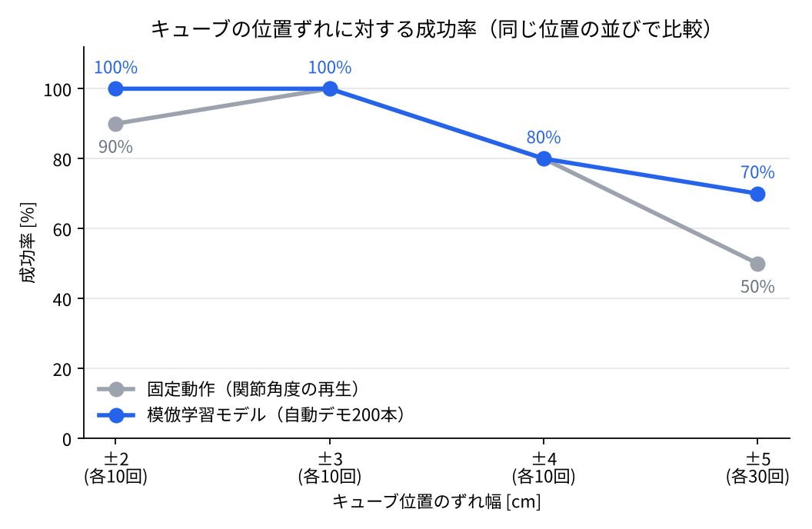
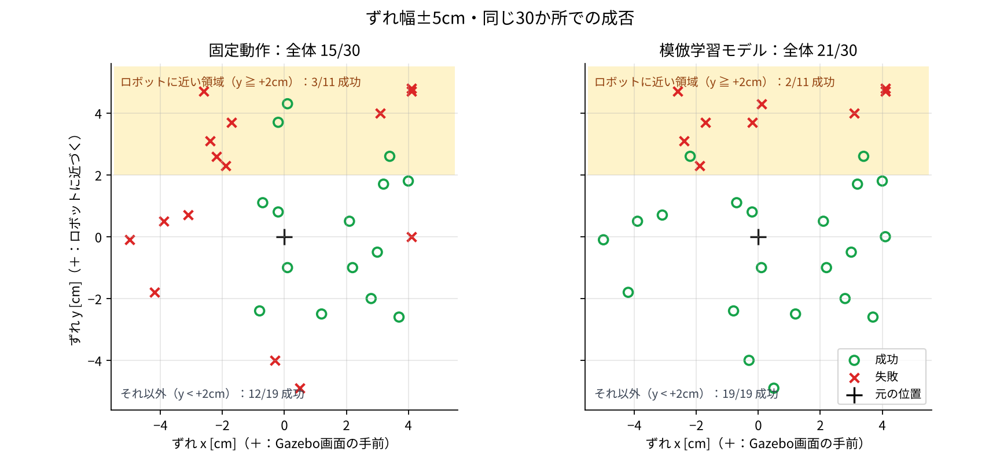

# 逆運動学による自動デモ生成と模倣学習
### — カメラ画像からキューブの位置を判断して掴む（Physical AI 最終課題）

ROS 2 + Gazebo 上の 4 軸ロボットアーム **CRANE+ V2** に，位置がずれたキューブを掴んで持ち上げさせるタスクです。
固定カメラの画像と関節角度を入力とする CNN を**模倣学習（Behavior Cloning）**で学習させ，キューブの位置ずれに合わせて掴めるようにしました。

- 動画：https://www.youtube.com/watch?v=LKKLGurxsBk
- 学習データは，人のテレオペではなく，**逆運動学を使って自動生成したデモ 200 本**です。



## 結果の要約

キューブを元の位置から最大 ±5cm ランダムにずらし，**同じ位置の並び**（乱数の種 0）で固定動作と比較しました。

| 手法 | ±5cm での成功率（30回） |
|---|---|
| 固定動作（決まった関節角度を再生） | 15/30（50%） |
| 関節ごとのテレオペ 11 本で学習したモデル | 0/3（0%） |
| **自動デモ 200 本で学習したモデル** | **21/30（70%）** |

- ロボットから離れた位置（y < +2cm）では，モデルは **19/19** 成功しました（固定動作は 12/19）。
- ロボットに近い位置（y ≧ +2cm，土台から約 8cm 以内）では，どちらもほとんど成功しません（固定動作 3/11，モデル 2/11）。手先を高く上げられずデモが少ない領域で，今後の課題です。
- 30 回の比較で「モデルのみ成功」8 回・「固定動作のみ成功」2 回（マクネマー検定 p ≈ 0.11）。全体の差は統計的に確定とまでは言えません。



## 取り組みの流れ

1. **固定動作**：決まった関節角度を再生するだけ（`action_publisher.py`）では，キューブが約 3cm 以上ずれると失敗する。
2. **関節ごとのテレオペ → 模倣学習（失敗）**：キーボードで関節を 1 つずつ操作してデモを 11 本集めたが（`my_teleop.py`，`record_teleop.py`），操作がばらばらで少なく，モデルは「平均的な小さい動き」しか出せず成功率 0%。
3. **操作方法の見直しと方針の転換**：ぎこちない関節ごとの操作を改善するため，各関節の角度を個別に操作するのではなく，手先（グリッパ）を下向きに保ったまま，その位置を x・y・z の 3 方向で操作するクレーンゲーム型のテレオペ（`crane_teleop.py`）を作り始め，そのために逆運動学（`crane_ik.py`）を実装した。しかし，人が操作する限り，動きのばらつきと本数の少なさは残る。そこで，人のテレオペを上手にするのではなく，同じ逆運動学でロボット自身に質のそろったデモを数多く作らせる方向を選んだ。
4. **逆運動学による自動デモ生成**（`auto_demo.py`）：
   「定位置（キューブの元の位置の真上 9cm）→ 同じ高さでキューブの真上へ水平移動 → 真下へ下ろす → 掴む」
   という質のそろったデモを自動生成（206 回中 200 回成功）。キューブの位置はシミュレータから取得するが，**モデルには与えない**。
5. **模倣学習**：200 本（約 19,000 フレーム）で CNN を学習し（`train_bc.py`），固定動作と同じ位置で評価（`run_policy.py`，`evaluate_replay.py`）。

## 環境

- Docker イメージ：`airobotbook/ros2-desktop-ai-robot-book-humble`（ROS 2 Humble，Ignition Gazebo Fortress）
- ロボット：CRANE+ V2（`crane_plus` パッケージ，`crane_plus_gazebo crane_plus_with_table.launch.py`）
- Python 3.10，PyTorch 2.6（CPU で学習・推論）

### シミュレーション環境の変更（`robot_config/`）

| ファイル | 内容 | 反映先 |
|---|---|---|
| `urdf/camera_front_low_v2_30deg.urdf.xacro` | 固定カメラの位置・向き（キューブの手前・机の高さ，ロボットとキューブを結ぶ線から 30° ずらす）＋ Gazebo の Sensors プラグイン | `crane_plus_description/urdf/camera.urdf.xacro` に上書き |
| `urdf/crane_plus.xacro` | カメラの支柱を無効化 | `crane_plus_description/urdf/crane_plus.xacro` に上書き |
| `cube/model.sdf` | キューブの色を赤に変更（重さ・摩擦は元のまま） | `~/.ignition/fuel/.../wood cube 5cm/3/model.sdf` に上書き |

反映後，`colcon build --symlink-install --packages-select crane_plus_description` を実行して Gazebo を起動し直します。

## プログラム（`src/`）

| ファイル | 役割 |
|---|---|
| `crane_ik.py` | 順運動学・逆運動学，定位置の定義（共通部品） |
| `auto_demo.py` | 逆運動学による自動デモ生成・記録（成功した回だけ保存） |
| `bc_model.py` | 模倣学習モデル（CNN：画像 160×120 ＋ 関節角度 → 関節の指令 ＋ グリッパ開閉） |
| `train_bc.py` | 学習 |
| `run_policy.py` | 学習したモデルでロボットを動かし，成功率を測る |
| `evaluate_replay.py` | 固定動作（`action_publisher.py`）の成功率を測る |
| `action_publisher.py` | 固定動作（決まった関節角度の再生） |
| `randomize_cube.py` | キューブを元の位置 ± 指定幅に置き直す |
| `my_teleop.py` | 関節ごとのキーボード操作のテレオペ（最初の挑戦で使用） |
| `record_teleop.py` | テレオペ中の画像・関節角度・指令の記録（最初の挑戦で使用） |
| `crane_teleop.py` | 手先の位置を x・y・z の 3 方向で操作するクレーンゲーム型のテレオペ（開発段階で終了。模倣学習には未使用） |
| `run_all.sh` / `compare_1030.sh` | 学習〜評価，比較計測を無人でまとめて実行 |

## 使い方

Gazebo を起動した状態で（テレオペなど，ほかにロボットへ指令を出すプログラムは止めておく）：

```bash
cd src

# 1. 自動デモの生成（成功した 200 本を保存）
python3 auto_demo.py --n 200 --outdir ../dataset_auto

# 2. 学習（Gazebo を閉じておくと速い。CPU で約 20 分）
python3 train_bc.py --data_dir ../dataset_auto --out ../models/bc_auto_v1.pt --val_episodes 10

# 3. 評価（±5cm を 30 回）
python3 run_policy.py --model ../models/bc_auto_v1.pt --delta 0.05 --trials 30

# 比較：固定動作の評価
python3 evaluate_replay.py --delta 0.05 --trials 30 --action ./action_publisher.py
```

学習済みモデル `models/bc_auto_v1.pt`（約 6MB）を同梱しているので，手順 3 だけでも動作を確認できます。

## 結果のデータ（`results/`）

- `replay_1030/`，`replay_1030_n30/`：固定動作の評価（2026/10/30，現在の環境）
- `model_1030_n30/`，`policy_results_bc_auto_v1_*.csv`：モデルの評価
- `replay/`：環境変更前（10/25）の固定動作の評価（参考）

学習データ（`dataset_auto/`，`dataset_teleop/`）は容量が大きいため，リポジトリには含めていません。

## 座標の向き

Gazebo の画面（動画と同じ，左手前にカメラ，右にロボットが見える視点）で，横方向に **y 軸（右がプラス）**，奥／手前方向に **x 軸（手前がプラス）** がある。
キューブの元の位置は，ロボットの真左 10cm のところ。「ずれ」は，この元の位置からの x・y の差。
